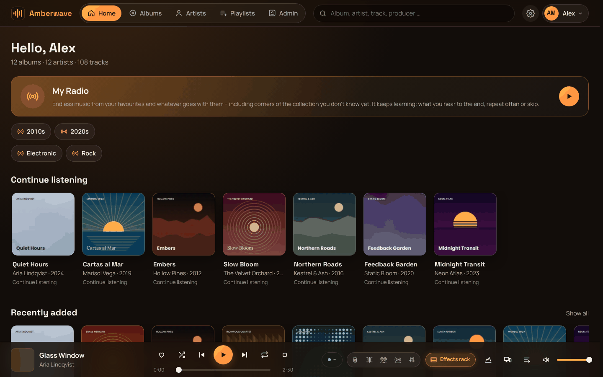

# Amberwave 0.9.1-beta.1

Selbst gehosteter Musikserver für die Familie: deine Sammlung (FLAC & Co.) im Browser, als installierbare Web-App und
im Windows-Client hören – zuhause bitgenau, unterwegs gestreamt, mit sauberen Metadaten von MusicBrainz und
Fernsteuerung zwischen allen Geräten. *English: [README.md](README.md)*

> **Beta:** Amberwave ist in der öffentlichen Beta. Mach vorher eine Sicherung deiner Musiksammlung. Amberwave liest
> deine Musik standardmäßig nur – geschrieben wird erst, wenn du es erlaubst.

Die Bilder zeigen eine Demo-Sammlung mit erfundenen Künstlern und erzeugten Covern.

## Pro-Funktionen – in der Beta kostenlos

Diese Funktionen sind später als kostenpflichtige **Pro**-Funktionen geplant. In der Beta sind sie **für alle kostenlos**:

- **DSP-Effekte:** AmberGlow (Röhre), AmberIron (Übertrager), AmberSilk (Band), AmberSpace (Raumhall und 5.1-Upmix), EQ
- **VST3-Plug-ins** im Windows-Client
- **ASIO-Ausgabe** im Windows-Client
- **Ausgangs-Routing-Matrix mit EQ pro Kanal**

Alles andere – Bibliothek, MusicBrainz-Abgleich, Streaming, Fernsteuerung, Familienkonten, Web-App und bitgenaue
WASAPI-Wiedergabe im Windows-Client – ist der kostenlose Kern.

## Installation mit dem fertigen Image (empfohlen)

1. Einen Ordner anlegen, z. B. `/opt/amberwave` (Unraid: `/mnt/user/appdata/amberwave`), und `docker-compose.yml` und
   `.env.example` hineinlegen.
2. `.env.example` nach `.env` kopieren und die Pfade eintragen:
   - `MUSIK_PFAD` – deine Sammlung, z. B. `/mnt/user/musik`
   - `APPDATA_PFAD` – Daten von Amberwave (Datenbank, Cover, Schlüssel, Sicherungen), am besten auf der SSD,
     z. B. `/mnt/cache/appdata/amberwave`
   - `APP_PORT` – Standard 9950
   - `PUID`/`PGID` – leer lassen (wird erkannt) oder wie Lidarr & Co. auf Unraid `99`/`100`
3. Starten: `docker compose up -d`
4. **Einrichten:** Im Log (`docker logs amberwave_app`) steht der Link mit Code, z. B. `http://<server>:9950/einrichtung.php?code=…`.
   Der Assistent prüft Ordner und Rechte, fragt, ob Amberwave im Musikordner schreiben darf (Standard: nein), legt
   Datenbank und Admin-Konto an und zeigt am Ende einmal den Schlüssel für gespeicherte Zugangsdaten (Kopie liegt
   neben den Sicherungen).
   - Ohne den Link fragt die Seite nach dem **Einrichtungscode** (im Log und in
     `<APPDATA_PFAD>/cache/geheimnisse/einrichtungscode`). Das Fenster ist 30 Minuten nach dem Start offen.
5. Musik einlesen (macht der Assistent direkt), danach Alben über **„Abgleichen“** mit MusicBrainz verknüpfen.

**Update:** `docker compose pull && docker compose up -d`. Die Datenbank wird beim Start automatisch angepasst; Musik,
Daten und `.env` bleiben. Die Verwaltung zeigt an, wenn es eine neue Version gibt.

**Neu anfangen:** Stack stoppen, `<APPDATA_PFAD>/db` und `<APPDATA_PFAD>/cache/geheimnisse` löschen, neu starten.

Notfall-Zugang: `docker exec -it amberwave_app php /var/www/html/scripts/create_admin.php <name> <email> <passwort>`

### Unraid (Docker Compose Manager)

1. Unter **Apps** (Community Applications) das Plugin **Docker Compose Manager** installieren.
2. Im **Docker**-Tab ganz unten **Add New Stack**, Name `amberwave`.
3. Beim neuen Stack ⚙ → **Edit Stack → Compose File**: den Inhalt von `docker-compose.yml` einfügen, speichern.
4. ⚙ → **Edit Stack → ENV File**: den Inhalt von `.env.example` einfügen und anpassen, z. B.
   `MUSIK_PFAD=/mnt/user/musik`, `APPDATA_PFAD=/mnt/cache/appdata/amberwave`, `PUID=99`, `PGID=100`.
5. **Compose Up**. Den Einrichtungslink findest du im Docker-Tab beim Container `amberwave_app` unter **Logs**.

Update: beim Stack **Update Stack** (bzw. **Compose Pull**, dann **Compose Up**).

### Synology (DSM 7.2, Container Manager)

1. Einen Ordner anlegen, z. B. `/volume1/docker/amberwave`, und `docker-compose.yml` und die `.env` hineinlegen
   (`MUSIK_PFAD=/volume1/music`, `APPDATA_PFAD=/volume1/docker/amberwave/data`; `PUID`/`PGID` = Besitzer der Musik,
   oft `1026`/`100` – per SSH mit `id <benutzer>` prüfen).
2. Container Manager → **Projekt → Erstellen**, diesen Ordner als Pfad wählen, „Vorhandene docker-compose.yml verwenden“
   → **Erstellen**.
3. Den Einrichtungslink findest du unter Container → `amberwave_app` → Protokoll.

Update: Projekt `amberwave` → **Aktion → Erstellen** (holt das neue Image).

### Selbst bauen (bisherige Art)

`docker-compose.build.yml` baut das Image lokal und bindet den Code als Ordner ein (`AMBERWAVE_ORDNER` in der .env auf
den Ordner mit `app/` und `docker/`). Start: `docker compose -f docker-compose.build.yml up -d --build`. Updates
dann als Zip unter **Einstellungen → Sicherung & Update → Neue Version einspielen** (vorher wird automatisch gesichert).
Für Entwickler: nach Änderungen an `app/js/*.js` neu bündeln (`bash app/scripts/buendeln.sh`, braucht [bun](https://bun.sh)).

## Sicherheit der Sammlung

- **Musikordner:** Standard „nur lesen“. Tags schreiben, „Dateien aufräumen“, Download-Import, „Aus anderem Album
  übernehmen“ und der Papierkorb sind gesperrt, bis du unter **Einstellungen → Bibliothek & Automatik → Musikordner** das Schreiben
  erlaubst (oder `MUSIK_SCHREIBEN=1`). Harter Schutz zusätzlich: `MUSIK_MOUNT_MODUS=ro` in der .env.
- Auch mit Schreibrecht passiert nichts von selbst: „Dateien aufräumen“ zeigt immer erst eine Vorschau, ausgeführt wird
  nur Freigegebenes; Altes landet im Papierkorb-Ordner `.amberwave-papierkorb`.
- **Usenet-Downloads** sind standardmäßig aus (Einstellungen → Downloads).

## Von unterwegs

- **Cloudflare Tunnel** (im Stack enthalten, braucht eine eigene Domain bei Cloudflare): Einstellungen → Zugang & Netz →
  „Von unterwegs: Cloudflare Tunnel“. Amberwave legt Tunnel und DNS-Eintrag selbst an; kein offener Port, funktioniert auch hinter CGNAT.
  Für den Tunnel gelten die [Nutzungsbedingungen von Cloudflare](https://www.cloudflare.com/terms/) – Musik in
  Haushaltsmengen ist dort eine Grauzone. Ohne Tunnel: `TUNNEL_IM_STACK=0`.
- **Tailscale / WireGuard:** Amberwave über die VPN-Adresse des Servers öffnen (`http://<vpn-ip>:9950`). Ohne HTTPS lässt sich die Web-App nicht installieren und offline nutzen – dafür einen Proxy mit Zertifikat davor oder Tailscale Serve/HTTPS verwenden.
- **Eigener Reverse Proxy** (Nginx Proxy Manager, Traefik, Caddy): auf `http://<server>:9950` zeigen lassen, in der
  .env `APP_URL=https://musik.example.de` und `PROXY_IPS=<IP des Proxys>` setzen.
- **Direktzugang im Heimnetz** (HTTPS mit eigenem Zertifikat, schneller als über den Tunnel): Einstellungen → Zugang & Netz.
  Details in [CHANGELOG.md](CHANGELOG.md) unter „Direktzugang einrichten“.

## Windows-Client

Bitgenaue Wiedergabe über WASAPI exklusiv oder ASIO, lückenlos, Abtastrate folgt der Datei, Effekte und VST3-Plug-ins.
Download unter den Releases. Er ist (noch) nicht signiert – Windows zeigt beim ersten Start „Der Computer wurde durch
Windows geschützt“: **Weitere Informationen → Trotzdem ausführen**. Details: [windows-client/README.md](windows-client/README.md).

VST3-Plug-ins sind in der Beta **experimentell**: Jedes Plug-in läuft in einem eigenen Prozess, ein Absturz hält die
Musik nicht an – fremde Plug-ins sind aber die häufigste Fehlerquelle. Bitte Probleme mit Name und Version melden.

## Bekannte Grenzen der Beta

- **Die Oberfläche braucht noch Feinschliff** – die Balance zwischen einfach, schön und detailliert ist noch nicht
  überall gefunden. Rückmeldungen dazu sind sehr willkommen.
- Docker-Image nur für x86-64 (ARM/Raspberry Pi folgt).
- Der Windows-Client ist nicht signiert und aktualisiert sich nicht selbst (er meldet aber neue Versionen).
- Noch keine Subsonic-Schnittstelle – Subsonic-Apps funktionieren nicht; dafür gibt es die installierbare Web-App.
- Keine Telemetrie, keine Installations-Kennung: Amberwave meldet nichts nach außen.

## Roadmap

Ohne Termine, nur die Richtung:

- **Mittelfristig:** Amberwave-Server für Windows (ohne Docker).
- **Langfristig:** eine eigenständige Windows-Version (Server und Player in einem), eine Android-App.
- **In weiterer Ferne, aber nicht ausgeschlossen:** Versionen für macOS, iPhone und Linux.
- Unterwegs: Feinschliff der Oberfläche, ARM-Image, mehr Werkzeuge – je nach euren Rückmeldungen.

## Häufige Fragen

**Verändert Amberwave meine Dateien?** Standardmäßig nicht. Der Musikordner ist schreibgeschützt, bis du es erlaubst –
und auch dann läuft jede Änderung erst nach Vorschau und Freigabe.

**Was unterscheidet Amberwave von Plex, Jellyfin oder Navidrome?** Nur Musik, dafür gründlich: MusicBrainz-Editionen
und vollständige Mitwirkende, bitgenaue Wiedergabe im eigenen Windows-Client, Fernsteuerung zwischen allen Geräten und
Familienkonten mit Freischaltung und Ablauf. Kein Video.

**Wo liegen meine Daten?** Alles, was Amberwave anlegt, liegt in `APPDATA_PFAD` (Datenbank, Cover, Schlüssel). Die
Datenbank wird täglich und vor jedem Update gesichert; den Ordner zusätzlich mit der normalen NAS-Sicherung sichern.

**Ist Amberwave kostenlos?** Der Kern ist kostenlos und Open Source (AGPL-3.0). DSP-Effekte, VST3, ASIO und die
Ausgangs-Routing-Matrix mit EQ pro Kanal sind als Pro-Funktionen geplant – in der Beta sind sie für alle kostenlos.

## Mehr

- Alle Einstellungen der .env: [.env.reference](.env.reference) – fast alles davon geht auch in der App.
- Was sich geändert hat: [CHANGELOG.md](CHANGELOG.md)
- Fehler melden: GitHub Issues · Fragen und Ideen: [r/Amberwave](https://www.reddit.com/r/Amberwave)
- Lizenz: AGPL-3.0 ([LICENSE](LICENSE)), Fremdkomponenten: [THIRD_PARTY_NOTICES.md](THIRD_PARTY_NOTICES.md)
