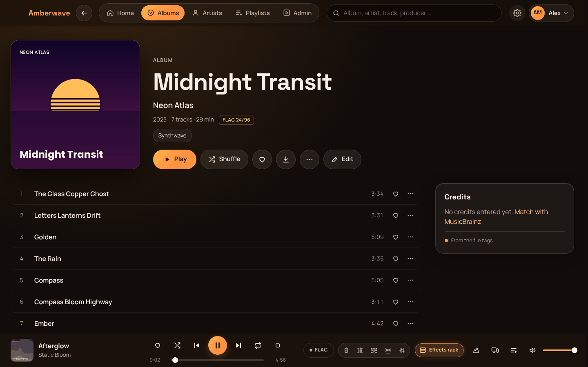
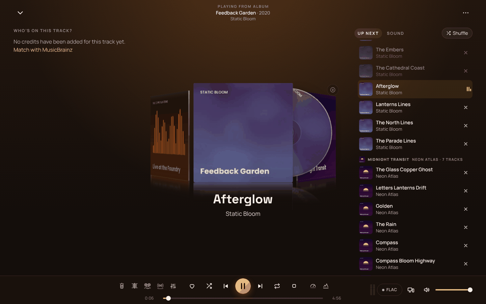
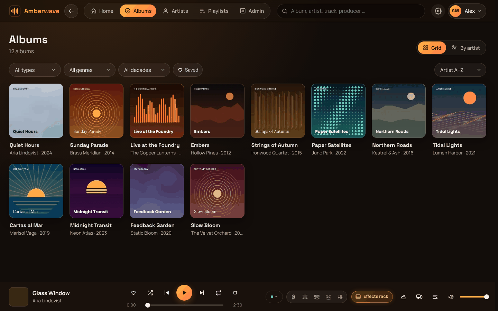
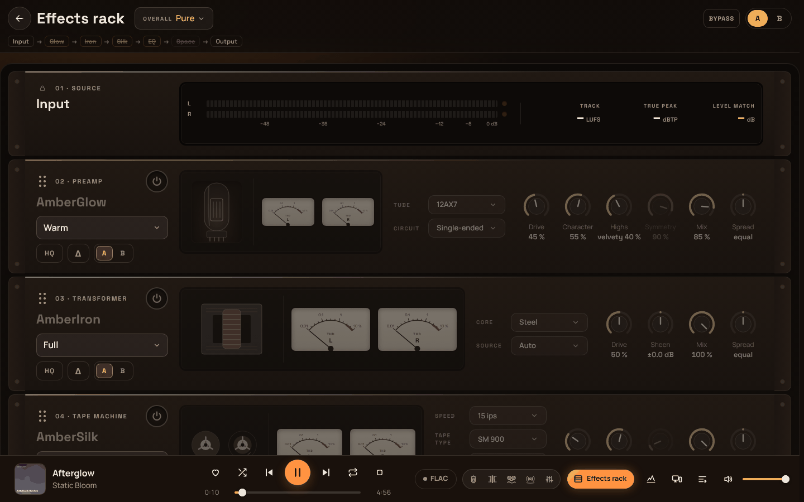

# Amberwave

> **One app instead of five:** your library, bit-perfect output, effects, VST3, per-channel routing and remote control –
> no virtual cables, no driver hacks.

**A self-hosted music server for your family's collection** – listen in the browser, as an installable web app (PWA) or
in a bit-perfect Windows client. At home you get the original files, on the go a smooth stream; every device can
remote-control every other one. Metadata comes from MusicBrainz, with credits down to producers and session musicians.

**Why Amberwave?** My goal is to make listening to music on your PC an *experience* again – away from minimalist
interfaces where the album covers are the only colour on the screen. Amberwave has warmth and character: a record
crate for your queue, VU meters, tubes and tape machines in the effects rack. And it brings together what used to take
several programs and sketchy driver routing – library, bit-perfect playback, effects, plug-ins, multi-channel routing
and remote control – in one place.

> **Public beta – 0.9.1-beta.3.** Please back up your music before you try it. Amberwave only **reads** your music
> by default; it writes nothing until you allow it. *Deutsche Anleitung: [README.de.md](README.de.md)*

| | |
|---|---|
|  |  |
|  |  |

Screenshots use a demo library with made-up artists and generated cover art.

## What it does

- **Your library, cleaned up:** FLAC, ALAC, MP3, Opus, OGG, WAV, AIFF, WavPack and more. Albums are matched against
  MusicBrainz (all editions, track-by-track comparison), plus recognition by sound (AcoustID) for untagged files.
  Credits link artists, producers, songwriters and musicians with their instruments.
- **Plays everywhere:** web app for desktop, tablet and phone (installable, lock-screen controls, offline listening),
  gapless playback, loudness normalisation (EBU R128), "now playing" with a record-crate view of your queue.
- **Remote streaming:** at home the original file, on the go Opus 256/160/128 depending on device and network –
  remembered per device. Remote access via the built-in Cloudflare Tunnel, Tailscale/WireGuard or your own reverse proxy.
- **Remote control:** your phone controls the PC, the PC controls the living-room client – queue, volume, skip.
  Also plays to DLNA/UPnP renderers (AV receivers, streamers) and Google Cast devices.
- **Windows client:** bit-perfect output via WASAPI exclusive or ASIO, sample rate follows the file, gapless,
  plus effects (tube, transformer, tape, EQ, 5.1 upmix with real room responses) and your own VST3 plug-ins.
- **Family accounts:** registration with approval, expiry, per-user history, favourites, shared playlists, radios.
- **Optional:** tidy up files and tags (preview first, then your approval), Usenet search via Prowlarr/Newznab with
  SABnzbd (off by default), WAV export for mixing desks.

## Pro features – free during the beta

These are planned as paid **Pro** features later. During the beta they are **free for everyone**:

- **DSP effects:** AmberGlow (tube), AmberIron (transformer), AmberSilk (tape), AmberSpace (room reverb and 5.1 upmix), EQ
- **Saturation focus:** per effect, a curve with draggable points decides where it saturates (EQ before, the exact
  opposite after – the tone stays neutral and only the distortion moves; de-emphasis 0–100 %).
- **VST3 plug-in support** in the Windows client
- **ASIO output** in the Windows client
- **Output routing matrix with per-channel EQ**

Everything else – library, MusicBrainz matching, streaming, remote control, family accounts, the web app and
bit-perfect WASAPI playback in the Windows client – is the free core.

## Quick start (Docker)

You need Docker with Compose on a Linux host or NAS with an x86-64 CPU (Unraid, Synology, TrueNAS, a plain Linux box).
ARM devices such as a Raspberry Pi are not supported yet.

1. Create a folder, e.g. `/opt/amberwave`, and put [`docker-compose.yml`](docker-compose.yml) and
   [`.env.example`](.env.example) into it.
2. Copy `.env.example` to `.env` and set the paths: `MUSIK_PFAD` (your music), `APPDATA_PFAD` (Amberwave's own data –
   SSD recommended) and, if you like, `APP_PORT` (default 9950). Leave `PUID`/`PGID` empty unless you know you need them
   (Unraid: `99`/`100`).
3. `docker compose up -d`
4. Open `http://<server>:9950` from a computer on your home network (or the setup link from `docker logs amberwave_app`). The assistant
   checks folders and permissions, asks whether Amberwave may write to your music folder (default: no), creates the
   database and your admin account, and scans your music.
   - From the home network no code is needed. Via a proxy, tunnel, the Docker bridge or the internet the page asks for the
     **setup code** (in the log; the link there already contains it). The setup window closes 30 minutes after the
     container starts (restart the container to reopen it).
5. Match albums with MusicBrainz ("Match" on an album, or automatically by sound with a free AcoustID key).

**Update:** `docker compose pull && docker compose up -d` – database changes run automatically. The admin overview tells
you when a new release is out (switch off under Settings → Backup & update).

**Unraid:** install the **Docker Compose Manager** plugin from Apps, then Docker tab → **Add New Stack** (`amberwave`)
→ ⚙ **Edit Stack → Compose File** (paste `docker-compose.yml`) and **Edit Stack → ENV File** (paste `.env.example`, e.g.
`MUSIK_PFAD=/mnt/user/music`, `APPDATA_PFAD=/mnt/cache/appdata/amberwave`, `PUID=99`, `PGID=100`) → **Compose Up**.
The setup link is in the logs of the `amberwave_app` container. Update with **Update Stack**.

**Synology (DSM 7.2, Container Manager):** create a shared folder for Amberwave's data, e.g. `/volume1/docker/amberwave`,
and put `docker-compose.yml` and your `.env` into it (`MUSIK_PFAD=/volume1/music`, `APPDATA_PFAD=/volume1/docker/amberwave/data`;
`PUID`/`PGID` = the user that owns your music, often `1026`/`100` – check with `id <user>` over SSH). Then Container Manager →
**Project → Create**, choose that folder as path and "Use existing docker-compose.yml" → **Build**. The setup link is in the
log of `amberwave_app` (Container → amberwave_app → Log). Update: Project → amberwave → **Action → Build** (pulls the new image).

**Self-build instead of the image:** [`docker-compose.build.yml`](docker-compose.build.yml) (mounts the code as a folder;
updates then come as a zip under Settings → Backup & update). Every `.env` option is documented in
[`.env.reference`](.env.reference) – almost all of them can also be changed in the app.

## Safety defaults

- **Music folder read-only:** writing tags, tidy-up, download import and the trash folder stay locked until you allow
  writing (setup assistant or Settings → Library & automation → Music folder, or `MUSIK_SCHREIBEN=1`). For a hard
  guarantee also mount it read-only: `MUSIK_MOUNT_MODUS=ro`.
- Even with writing allowed nothing happens on its own: tidy-up always shows a preview and only runs what you approve;
  replaced files go to `.amberwave-papierkorb` inside your music folder.
- **Usenet downloads are off** until you switch them on (Settings → Downloads). You are responsible for what you download.
- No telemetry, no installation ID, no counting of installations. Amberwave talks to MusicBrainz, Cover Art Archive, AcoustID, fanart.tv, Deezer and ListenBrainz for
  metadata, to GitHub for the update notice, and – only if you set them up – to Cloudflare and your own services.

## Remote access

- **Cloudflare Tunnel** (included in the stack, needs your own domain on Cloudflare): Settings → Access & network →
  "When you are away: Cloudflare Tunnel". Amberwave creates the tunnel and DNS record; no open router port, works behind CGNAT. Cloudflare's
  [terms](https://www.cloudflare.com/terms/) apply – streaming household amounts of music is a grey area there.
  Not using it? Set `TUNNEL_IM_STACK=0`.
- **Tailscale / WireGuard:** open `http://<vpn-ip>:9950`. Without HTTPS the web app can't be installed or used offline –
  put a proxy with a certificate in front, or use Tailscale's HTTPS.
- **Your own reverse proxy** (Nginx Proxy Manager, Traefik, Caddy): point it at `http://<server>:9950` and set
  `APP_URL=https://music.example.com` and `PROXY_IPS=<proxy IP>` in `.env`.

## Windows client

Download it from the [releases](../../releases). It is not code-signed yet, so Windows SmartScreen shows "Windows
protected your PC" on first start: click **More info → Run anyway**. The client finds your server in the home network by
itself. Details: [windows-client/README.md](windows-client/README.md).

VST3 plug-in support is **experimental** in the beta: each plug-in runs in its own process, so a crashing plug-in doesn't
stop the music – but third-party plug-ins are the most likely source of trouble. Please report problems with the plug-in's
name and version.

## Known limitations of the beta

- **The interface still needs polish.** Finding the right balance between simple, good-looking and detailed is ongoing
  work – feedback on what feels cluttered or missing is very welcome.
- Docker image for amd64 only (arm64 needs the effects renderer ported).
- Code comments and parts of the documentation are German; the app itself is German and English.
- The Windows client is unsigned, has no auto-update yet (it tells you when a new version is out) and VST3 support is
  experimental.
- No Subsonic/OpenSubsonic API yet, so third-party Subsonic apps don't work – use the web app (installable on phones)
  or the Windows client.

## Roadmap

No dates, just direction:

- **Mid-term:** Amberwave server for Windows (no Docker needed).
- **Long-term:** a standalone Windows version (server and player in one), an Android app.
- **Further out, not ruled out:** versions for macOS, iPhone and Linux desktops.
- Along the way: UI polish, arm64 image, more import and tidy-up tools – shaped by your feedback.

## FAQ

**Does Amberwave change my files?** Not by default. The music folder is read-only until you allow writing, and even
then every change (tags, renaming, tidy-up) is shown as a preview first and only runs after you approve it.

**How is it different from Plex, Jellyfin or Navidrome?** Amberwave is music-only and built around a well-kept library:
MusicBrainz editions and full credits, bit-perfect playback in its own Windows client, remote control between all your
devices and a family setup with accounts that need approval and can expire. It does not do video.

**What hardware do I need?** Any x86-64 machine that runs Docker. The first scan of a large library takes a while
(every file is read once – about 100 files per second in our load test). Keep the app data on an SSD if you can.
With 100,000 tracks, lists, album pages and search answer in well under a second; a search with a typo takes about a
second (load test on MariaDB 11.4).

**Where is my data, and how do I back it up?** Everything Amberwave creates lives in `APPDATA_PFAD` (database, covers,
keys). Amberwave backs up its database daily (Settings → Backup & update) and before every update. Back up the
app-data folder with your usual NAS backup as well.

**Can I use it without MusicBrainz?** Yes – albums work from your file tags alone. Matching adds editions, credits and
better artist pages.

**Is it free?** The core is free and open source (AGPL-3.0). DSP effects, VST3 support, ASIO output and the output
routing matrix with per-channel EQ are planned as Pro features – during the beta they are free for everyone
(see [Pro features](#pro-features--free-during-the-beta)).

**I found a bug / have an idea.** [GitHub issues](../../issues) for bugs, [r/Amberwave](https://www.reddit.com/r/Amberwave)
for questions and ideas.

## Feedback

- Bugs: [GitHub issues](../../issues) (templates included) · questions and ideas: [r/Amberwave](https://www.reddit.com/r/Amberwave)
- Security problems: please report privately, see [SECURITY.md](SECURITY.md).
- Contributing: [CONTRIBUTING.md](CONTRIBUTING.md) (includes a short CLA).

## License

Amberwave is licensed under the **GNU Affero General Public License v3.0** – see [LICENSE](LICENSE).
Third-party components: [THIRD_PARTY_NOTICES.md](THIRD_PARTY_NOTICES.md). History: [CHANGELOG.md](CHANGELOG.md).
